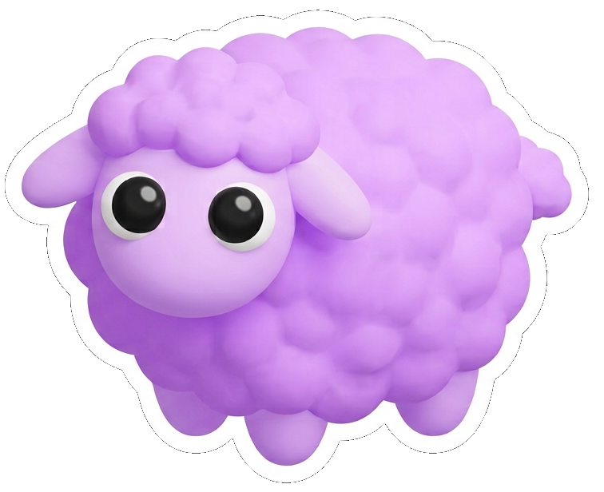

# WMT26 - LiLa 

Repository accompanying the **LiLa** submission to the **WMT 2026 General Machine Translation Task**.

## Scope

The project covered:

- NLLB fine-tuning for English to Ladin (Val Badia) (`eng_Latn` → `lld_Latn`)
- LLM continued pre-training (CPT) and instruction tuning for Ladin language and translation tasks

## Released artifact

- [`lila_nllb-1_3B.ipynb`](./notebooks/nllb/lila_nllb-1_3B.ipynb): the Colab notebook used for the NLLB 1.3B workflow, including fine-tuning, evaluation, model export, and WMT26 inference/output validation.

## LLM adaptation approaches

- **Continued pre-training (CPT):** further pre-training a language model on Ladin text to improve its familiarity with the language.
- **Instruction tuning:** fine-tuning a language model on instruction-formatted examples so it can follow translation and other language-task prompts.

These approaches are part of the project, but their training code and notebooks are not included in this release.

## Released models (Hugging Face)

Collection of models from the paper “LiLa at WMT 2026 General MT Task” on Ladin and Ligurian machine translation:

[https://huggingface.co/collections/ConseggioLigure/lila](https://huggingface.co/collections/ConseggioLigure/lila)

## Notes

- The released workflow is the NLLB notebook above, which was run in Google Colab; no other training or inference notebooks are part of this release.
- The notebook expects a Colab GPU runtime, Google Drive, and the required datasets and WMT26 input files to be available there.
- Logo generated with Google Gemini (**Prompt:** *A cute 3D vector emoji of a fluffy lilac-purple sheep, vibrant pastel lavender fleece, big glossy eyes, isolated on a white background, minimalist digital sticker style.*)
