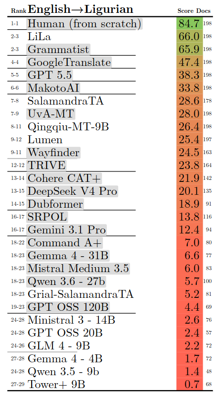
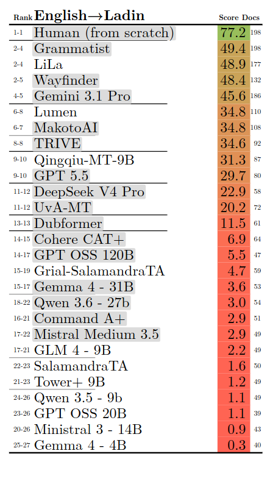

# WMT26 - LiLa 

This repository accompanies **LiLa**, our submission to the [WMT 2026 General Machine Translation Task](https://github.com/wmt-conference/wmt26-general-mt/). We participated in the General MT shared task with models for Ladin and Ligurian.

## Scope

The project covered:

- NLLB fine-tuning for English to Ladin (Val Badia) and Ligurian (`eng_Latn` → `lld_Latn` and `eng_Latn` → `lij_Latn`)
- LLM continued pre-training (CPT) and instruction tuning for Ladin and Ligurian language and translation tasks

## Released artifact

- [`lila_nllb-1_3B.ipynb`](./notebooks/nllb/lila_nllb-1_3B.ipynb): the Colab notebook used for the NLLB 1.3B workflow, including fine-tuning, evaluation, model export, and WMT26 inference/output validation.

## LLM adaptation approaches

- **Continued pre-training (CPT):** further pre-training a language model on Ladin text to improve its familiarity with the language.
- **Instruction tuning:** fine-tuning a language model on instruction-formatted examples so it can follow translation and other language-task prompts.

These approaches are part of the project, but their training code and notebooks are not included in this release.

## Released models (Hugging Face)

Collection of models from the paper “LiLa at WMT 2026 General MT Task” on Ladin and Ligurian machine translation:

[https://huggingface.co/collections/ConseggioLigure/lila](https://huggingface.co/collections/ConseggioLigure/lila)

## Final rankings

Final rankings for our English-to-Ligurian and English-to-Ladin systems in the WMT 2026 General MT shared task:

### English → Ligurian



### English → Ladin



## Citation

If you use this work, please cite:

```bibtex
@InProceedings{bueno-EtAl:2026:wmt,
  author    = {Bueno, Mirelle Candida  and  Domingues, Lucas  and  Frontull, Samuel  and  Maillard, Jean  and  Garg, Sushil},
  title     = {LiLa at WMT 2026 General MT Task: Exploring Beyond NMT and Learning the Limits of LLM Adaptation for Ligurian and Ladin},
  booktitle = {Proceedings of the Eleventh Conference on Machine Translation},
  month     = {October},
  year      = {2026},
  address   = {Budapest, Hungary},
  publisher = {Association for Computational Linguistics},
  pages     = {1210--1219},
  abstract  = {We describe LiLa, our submission to the constrained track of the WMT 2026 General Machine Translation Task. Motivated by recent advances in large language models (LLMs) and their increasing availability as open models, we investigate the adaptation of LLMs for Ligurian and Ladin, two low-resource languages included in the shared task. We evaluate several adaptation strategies for Gemma-4, including Instruction Tuning (IT-only), continuous pre-training followed by Instruction Tuning (CPT+IT), and Low-Rank Adaptation (LoRA), and compare them with a dedicated encoder-decoder pipeline based on fine-tuned No-Language Left Behind (NLLB) models. Our experiments show that, under the evaluated conditions, fine-tuned NLLB models achieve higher automatic translation scores than the investigated LLM adaptation strategies. Based on these results, our final submission adopts a fine-tuned NLLB-based translation pipeline. We discuss the main observations from the different approaches explored during development. We release the code and models produced in these experiments through a publicly accessible GitHub repository https://github.com/schtailmuel/wmt26-lila/},
  url       = {https://aclanthology.org/2026.wmt-1.60}
}
```

## Notes

- The released workflow is the NLLB notebook above, which was run in Google Colab; no other training or inference notebooks are part of this release.
- The notebook expects a Colab GPU runtime, Google Drive, and the required datasets and WMT26 input files to be available there.
- Logo generated with Google Gemini (**Prompt:** *A cute 3D vector emoji of a fluffy lilac-purple sheep, vibrant pastel lavender fleece, big glossy eyes, isolated on a white background, minimalist digital sticker style.*)
